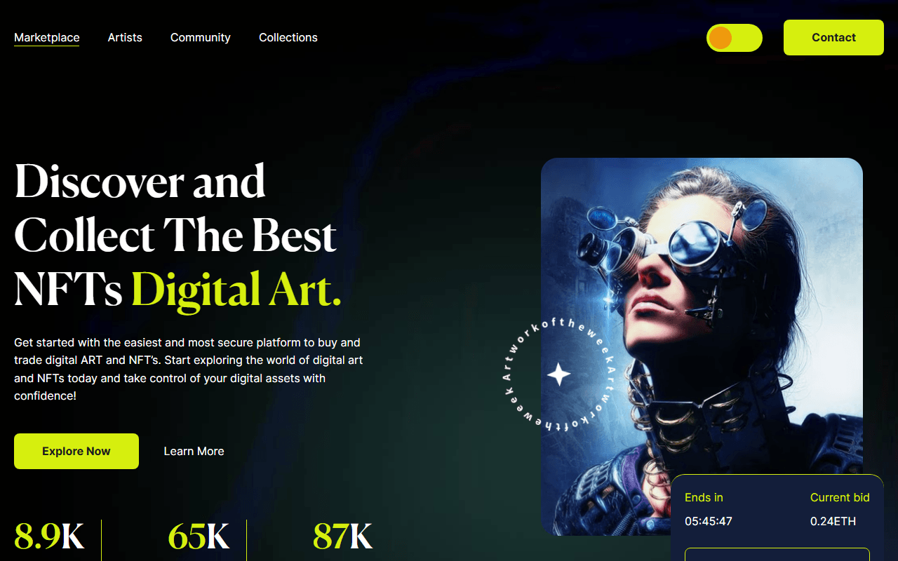

# Digital Art — NFT Marketplace Landing Page

A responsive landing page for a digital art / NFT marketplace: hero with live auction card, unique art slider, best NFTs, popular artists and a newsletter form. Learning project built from a design mockup.



**Live demo:** https://kolesander-2020.github.io/digital-art-nft-landing/

## Stack

- HTML5 (partials via `vite-plugin-html-inject`)
- SCSS (modules, variables, mixins), PostCSS (Autoprefixer, px → rem, sorted media queries)
- JavaScript (ES modules)
- [Vite](https://vitejs.dev/)
- [Splide](https://splidejs.com/) — artwork slider
- [Pristine](https://pristine.js.org/) — form validation
- Responsive images: AVIF / WebP / PNG with `@1x` / `@2x`, SVG icons

## Features

- Responsive layout from mobile to desktop
- Preloader
- Colour theme switcher (toggle) remembered between visits
- Burger menu on mobile
- Artwork slider and newsletter form with validation
- Image optimisation at build time

## Getting started

```bash
npm i
npm run dev      # dev server
npm run build    # production build to dist/
npm run preview  # preview the build
```

---

Based on [Vite starter template](https://github.com/Grinch3214/vite-builder) by Maksym Hrichina.
